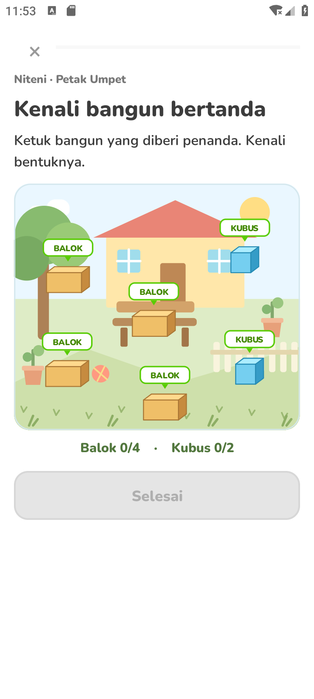
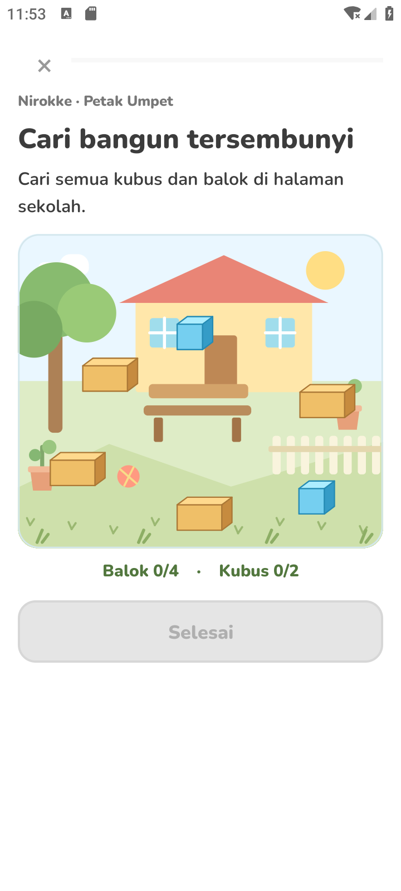
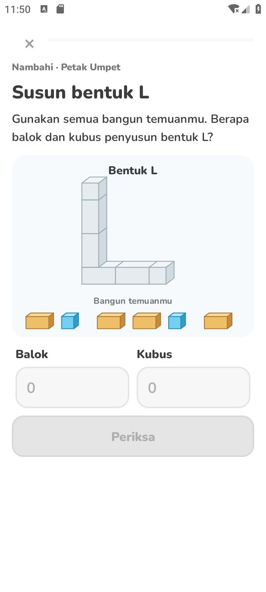
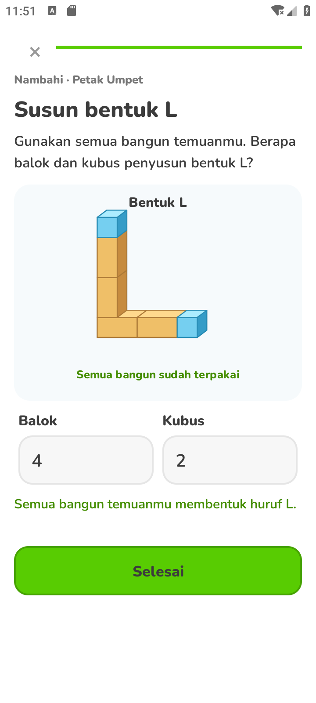

# Pengujian NusMatika V18

Tanggal: 19 November 2026. Aplikasi 0.13.0, versionCode 18, package id.nusmatika.dakon.

## Build dan pemeriksaan otomatis

Perintah standar: `gradlew testLogic assembleDebug lintDebug`. Hasil terakhir **BUILD SUCCESSFUL** menggunakan JDK 17, Gradle 8.11.1, AGP 8.9.2, SDK 35 dan Build-Tools 35.0.0.

Sepuluh program uji JVM lulus dengan **33.626 assertions**. Sebanyak 28.666 berasal dari pengujian lama Dakon, Balap, LKPD dan gerak; 4.960 berasal dari pengujian Petak Umpet. Termasuk pemeriksaan volume, dukungan bangun, tidak adanya tumpang tindih, bentuk L yang menyambung, hit region, urutan pencarian, input salah, snapshot rusak, pembukaan level dan latihan ulang.

Android Lint: **0 error, 43 warning**. Warning yang tersisa tidak memblokir build; antara lain penulisan string UI secara langsung. APK ditandatangani sebagai build debug dan berhasil dipasang pada emulator.

## Uji runtime

Perangkat: emulator AOSP Android 9 / API 28, tampilan 720 x 1600 dengan viewport sekitar 360 dp; juga diuji dengan ukuran logis 640 x 1280 untuk viewport 320 dp. Belum dilakukan pengujian HP fisik atau runtime Android 15.

| Skenario | Hasil |
| --- | --- |
| Memilih Petak Umpet dari kartu yang dapat digulir | Lulus |
| Niteni: label dan panah terlihat, enam objek dapat dikumpulkan | Lulus |
| Keluar paksa sesudah sebagian pencarian, lalu melanjutkan | Lulus; subset temuan tetap sama |
| Nirokke: objek yang belum ditemukan tanpa label/panah | Lulus |
| Menyelesaikan pencarian Nirokke pada viewport 320 dp | Lulus |
| Nambahi: input 3 balok dan 2 kubus | Ditolak, kedua isian dipertahankan |
| Menutup proses dan memulihkan isian Nambahi | Lulus; 3 dan 2 tetap tersimpan |
| Memperbaiki hitungan menjadi 4 balok dan 2 kubus | Diterima setelah Periksa |
| Susun bangun pada mode gerak normal | Lulus; animasi berakhir sebelum Selesai digunakan |
| Susun bangun pada mode gerak berkurang | Lulus; hasil langsung terlihat |
| Menutup proses setelah susunan terbentuk | Lulus; susunan dan tombol Selesai dipulihkan |
| Halaman selesai | Lulus; arena, soal, isian dan umpan balik lama disembunyikan |
| Mengulang Niteni/Nirokke setelah seluruh level selesai | Lulus; status level yang sudah terbuka tetap tersimpan |
| Membuka Niteni Dakon | Lulus |
| Membuka Niteni Balap Karung / garis JKW | Lulus |
| Log AndroidRuntime pada rangkaian uji | Tidak ditemukan crash proses NusMatika |

Seluruh font dan atlas Nara tetap identik dengan sumber V17. Aturan, soal dan penyimpanan Dakon/Balap tidak diubah. ID view dan pemisahan style API 27 dirapikan agar Lint lulus.

## Bukti tampilan

## Berkas APK

Nama: nusmatika-v18-petak-umpet-debug.apk

SHA256: `87cc7749c036ec13e8ba4fe94475cb0797d7240478007bd74b5a036b3f70bf07`

APK ini memakai kunci debug pengembangan baru. Kunci privat tidak disertakan dalam arsip sumber; pengujian pada instalasi V17 dengan kunci berbeda perlu memakai perangkat/emulator uji terpisah.

## Cakupan

Kerangka awal mencakup satu arena dengan dua penempatan objek dan satu tantangan bentuk L. Belum mencakup seluruh variasi soal atau materi tampak depan/atas/samping pada dokumen pemetaan CP.
